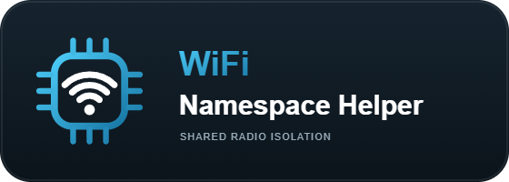

<!-- header:begin (generated from project metadata) -->
<h1 align="center">WiFi Namespace Helper</h1>

  

---

  
   
  
   
  
  
  
   
  
  
  
  

<!-- header:end -->

**English** · [Deutsch](README.de.md)

WiFi Namespace Helper lends one unused, AP-capable Wi-Fi radio to an isolated Home Assistant app, then restores its original host settings. It is independent of Tuya and suitable for other trusted tools that need a dedicated Wi-Fi adapter. Its authenticated local API uses a Unix socket and Linux network namespace descriptors; no TCP/HTTP listener or Docker API is involved.

Install from the [Home Assistant Apps catalog](https://github.com/seb5594/Home-Assistant-Apps). The host must run Home Assistant OS or another supported Supervisor installation with a working Wi-Fi driver and NetworkManager. Ethernet is recommended for Home Assistant's management connection. If no wireless interface exists at startup, the helper exits immediately with diagnostics.

## For users

1. Install **WiFi Namespace Helper** and your compatible client app.
2. In each app's Configuration tab enter the same private pairing secret of at least 32 characters. Use the client Web UI's secret generator if available.
3. Start the helper, then open the client app and choose an eligible unused adapter. An existing management connection is never taken over.
4. Stop the client/session before stopping the helper. The client must release the adapter or exit so its isolated namespace is destroyed. Read both apps' Log tabs if recovery remains pending.

Keep Protection mode and AppArmor enabled. Only the helper has host network, host D-Bus and NET_ADMIN. Clients retain isolated networking. The secret grants control to every app that knows it: share it only with trusted client apps. This is not a multi-tenant authorization service.

## For developers

- [Integration guide in English](docs/integration.en.md)
- [Integrationsanleitung auf Deutsch](docs/integration.de.md)
- [Wire API, authentication and recovery contract](docs/api.md)
- [Installable Python SDK](sdk/) and [complete example app](examples/minimal_app/)
- [Inventory-only example](examples/inventory.py) and [radio-job example](examples/radio_job.py)

SDK 1.0.0 implements **wire protocol 3**. The helper, SDK and client apps have independent release versions. Compatibility is checked by the protocol number, not equality of app version strings. Clients vendor a reviewed SDK revision and record its commit/checksums; building or installing them never requires the UnTuyaOS3 or Tuya Breaker repository.

## Migration from Anti Tuya WiFi Helper

The old companion's installed slug was `untuyaos3_wifi`. The new independent app uses `wifi_helper` and `/share/wifi-helper-private/wifi.sock`. This is an explicit migration, not a silent rename of an installed app.

1. Finish/cancel active sessions and stop the main apps. In the old helper log verify that the adapter returned and recovery completed. Never remove the old helper while recovery is pending.
2. Save the pairing secret privately. Install WiFi Namespace Helper from the catalog, enter that secret and start it.
3. Update/rebuild the client app to its standalone repository version. Its Web UI points to this new helper. Do not run both helpers at once.
4. Once the new helper and client work, remove the old Anti Tuya helper through Home Assistant. Existing recovery files belong to their originating helper; they are never silently copied or deleted.

All instructions for end users use Home Assistant's UI. No host shell, manual module loading, Docker commands or disabled protection are required. USB enumeration alone does not mean a usable Wi-Fi interface exists; drivers and firmware come from the HAOS kernel, not this container.

## Source and testing

The radio checks, namespace handover and recovery were extracted from the established UnTuyaOS3 companion. They retain the fail-closed checks for active addresses/routes, association, NetworkManager state, rfkill and a sole interface on the selected PHY. A real host handover is still the final driver capability check. See [architecture](docs/api.md#security-and-recovery) and [changelog](wifi_helper/CHANGELOG.md).

<!-- support:begin (generated, shared text) -->
## Say thanks

All my projects are built in my spare time, just for the fun of it. Still, they take a lot of time and care, and many of the smart home gadgets I buy end up here because I want to make them cloud-free and smart-home ready. Every bit of support means a lot to me.

If my work helped you or turned out to be useful, show your appreciation with a hot drink for my next sleepless night.

 
<!-- support:end -->

<!-- license:begin (generated from the license file) -->
## License

Published under the [MIT License](LICENSE).
<!-- license:end -->
